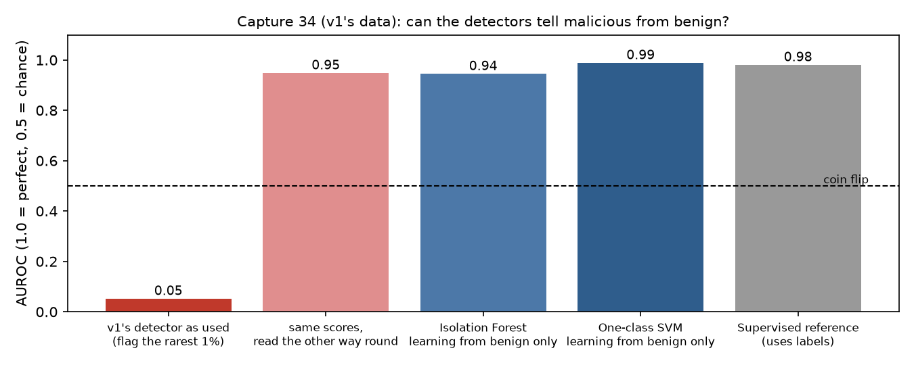

# ML Anomaly Detection in IoT Network Traffic

Finding malicious connections in IoT network logs without labels, redone honestly.

**Status:** v1 is a finished course assignment (2025). **v2 answers v1's own question on v1's own data** with better methods, and lets
the evidence decide (October 2026). Short version: malicious traffic *can* be found without labels; v1's method failed because it asked an
anomaly detector to find a majority class, and the engineered features turned out not to be the point.

**Contents:** [The question](#the-question) · [Version history](#version-history) · [Part A: v1's data](#part-a-v1s-question-on-v1s-data) · [Part B: does it travel?](#part-b-does-it-travel) · [Run v2](#run-v2) · [v1 (coursework)](#v1-coursework)

## The question

v1 asked: *can malicious connections in an IoT connection log be identified, without relying on labels, from features engineered out of the
raw columns?* v1 answered "not very accurate" (16 of 21,222 malicious connections caught).

**Hypothesis H1 (written before the final numbers):** malicious connections in capture 34 can be separated from benign ones without labels,
using engineered features, *and the engineered features are what make it work.* The walkthrough is
[`anomaly_detection_v2.ipynb`](anomaly_detection_v2.ipynb); the reasoning is in [`docs/v2-plan.md`](docs/v2-plan.md).

## Version history

| | v1: coursework | v2 |
|---|---|---|
| Code | the notebook, tag [`v1-coursework`](https://github.com/G-Eskayo/ML_unsupervised_learning-anomaly-detection-project/tree/v1-coursework) | `anomaly_features.py`, `anomaly_experiment.py`, `v2/run.py`, the notebook, `tests/` |
| Data | capture 34 (23,145 connections, **92% malicious**) | the same capture first, then five others |
| Method | Isolation Forest told 1% of traffic is anomalous | clustering; novelty detection (learn *normal* from benign only); a supervised reference; feature ablation |
| Scored with | accuracy, on the data it was fitted on | AUROC and average precision, cross-validated on time blocks; later, whole captures held out |
| Result | **16 of 21,222** malicious caught | AUROC **0.99** (one-class SVM, benign only); **0.97** balanced accuracy from 4 clusters |

## Part A: v1's question on v1's data



**v1's detector worked backwards.** In a capture that is 92% malicious the *rare* connections are the benign ones. Scoring
connections by how unusual they look gives AUROC **0.05** for spotting malicious (0.5 is a coin flip), so the unusual
connections are overwhelmingly benign, as the detector was built to find them. (Reading the scores the other way gives 0.95; that uses the
labels to pick a direction, so it is a diagnosis, not a method.)

**Methods that fit the data work** (the one-class SVM best; Isolation Forest ranks well, but at a 5% false-alarm budget it catches only 30%):

| Method (cross-validated on 5 time blocks) | AUROC | Average precision | Recall at 5% false alarms |
|---|---|---|---|
| Isolation Forest, learning from benign only | 0.94 | 0.99 | 0.30 |
| One-class SVM, learning from benign only | 0.99 | 1.00 | 1.00 |
| Supervised reference (uses labels) | 0.98 | 0.99 | 0.99 |

Clustering needs no labels at all: with 2 or 3 clusters it fails (balanced accuracy 0.50), with **4 it reaches 0.97**, and the clusters are the attack types (a DDoS cluster, a
benign cluster, two command-and-control clusters).

**But the engineered features are not why.** Dropping v1's rolling per-source connection count changes nothing (AUROC
0.985 against 0.980 with everything); dropping the byte and packet counts slightly helps. The protocol
alone (UDP or TCP) gives 0.97: the benign traffic here is NTP and DNS over UDP, and each attack hits one service (DDoS to port 80, command-and-control to
port 6667, the scan to high ports). This capture is easy.

### Verdict on H1

| Part of the hypothesis | Verdict |
|---|---|
| Malicious can be separated from benign without labels | **supported** (clustering 0.97; benign-only novelty detection 0.94 to 0.99 AUROC) |
| It works because of the engineered features | **not supported** (removing v1's feature changes nothing; protocol alone gives 0.97) |
| v1's own conclusion, "the approach was inaccurate" | **not supported**: the method v1 chose did not fit the data |

## Part B: does it travel?

**Train on capture 34 only, score the others.** AUROC capture 8: 1.00, capture 20: 0.99, capture 21: 0.98, capture 44: 0.99; **capture 42: 0.55**, about a coin flip:
42's malicious connections are file downloads, which capture 34 never contained.

**The setting anomaly detection assumes (mostly benign traffic).** Captures 20, 21, 42 and 44 are 89% to 99.9% benign. Each is held out in turn; the unsupervised detectors are fitted on the
others without labels.


| Mean over the 4 captures | Average precision | Recall at 1% false alarms | Recall at 5% false alarms |
|---|---|---|---|
| Random guessing | 0.03 | 0.01 | 0.05 |
| Isolation Forest | 0.54 | 0.60 | 1.00 |
| Local Outlier Factor | 0.27 | 0.31 | 0.40 |
| Supervised baseline (uses labels) | 0.68 | 0.63 | 0.73 |

Recall at 1% false alarms per capture (20 / 21 / 42 / 44): Isolation Forest 0.19 / 0.21 / 1.00 / 1.00; supervised 0.94 / 1.00 / 0.00 / 0.58. **Labels help only for attacks the model has seen:** the
supervised baseline wins on the Torii captures (20, 21) and finds none in capture 42, where the unsupervised detector finds all of them.

## Limits, plainly

- Capture 34 is one lab capture: one benign pattern and three scripted attacks. "Easy" is a property of the data. Nothing here says how it would do on a real network.
- Malicious counts in captures 20, 21, 42 and 44 are tiny (6 to 26), so differences between methods there are not conclusive.
- Part A scores are pooled across time blocks, two of which contain no benign traffic, and recall at a strict 1% false-alarm budget is low and fragile; the 5% figures are the dependable ones.
- Training samples are capped at 20,000 rows per capture.

### Run v2

```bash
scripts/fetch-data.sh       # downloads the Kaggle archive (755 MB) and unpacks the captures v2 uses
python -m venv .venv && .venv/bin/pip install scikit-learn pandas numpy matplotlib pytest
.venv/bin/python -m pytest tests -q
.venv/bin/python v2/run.py   # about 40 seconds; rewrites v2/results.json and the figures
.venv/bin/pip install nbformat nbconvert ipykernel && .venv/bin/python -m ipykernel install --user --name anomaly-v2
.venv/bin/python v2/build_notebook.py   # rebuilds the executed notebook
```

## v1 (coursework)

This project applies **unsupervised machine learning** to the **CTU-IoT Malware dataset**, with the goal of identifying anomalous network connections that may indicate **malware activity**. It demonstrates a full workflow of **EDA, preprocessing, feature engineering, and anomaly detection** for cybersecurity applications.

### Overview

- **Goal:** Detect malicious traffic in IoT network logs using unsupervised ML.
- **Dataset:** [CTU-IoT Malware Dataset (Kaggle)](https://www.kaggle.com/datasets/agungpambudi/network-malware-detection-connection-analysis)
- **Motivation:** Network logs contain millions of connections, but only a small fraction may be malicious. Detecting anomalies in high-dimensional data is a core cybersecurity challenge.

### Features

- **Exploratory Data Analysis (EDA):**
    - Inspected 23 features across ~23,000 network entries.
    - Analyzed categorical (IPs, ports, labels) and numerical attributes (packet size, duration).
- **Data Preprocessing:**
    - Dropped irrelevant/missing features.
    - Encoded categorical variables (IPs, ports).
    - Standardized numeric features with `StandardScaler`.
- **Feature Engineering:**
    - Created rolling counts of connections by source IP within 10-second windows.
    - Converted protocol-level details into categorical indicators.
- **Unsupervised Learning:**
    - Applied an `IsolationForest` anomaly detector to flag suspicious outliers.
- **Pipeline Design:**
    - Built scikit-learn pipelines with `ColumnTransformer` to unify preprocessing and modeling.

### Tech Stack

- **Language:** Python 3.x
- **Libraries:** pandas, numpy, scikit-learn, matplotlib, seaborn
- **Tools:** Jupyter Notebook

### How to Run

```bash
git clone https://github.com/G-Eskayo/ML_unsupervised_learning-anomaly-detection-project.git
cd ML_unsupervised_learning-anomaly-detection-project
pip install pandas numpy scikit-learn matplotlib seaborn jupyter
jupyter notebook ML_unsupervised_learning.ipynb
```

The notebook is also saved as [HTML](ML_unsupervised_learning.html) and [PDF](ML_unsupervised_learning.pdf) if you only want to read the results. Download the dataset from the Kaggle link above and point the notebook at it.


### What v1 found


The model is wrong in the way that matters: it catches **16 of 21,222** malicious connections (recall 0.00) and its overall accuracy is 0.07. The reason is visible in the data: 92% of these connections are malicious, but the notebook uses an `IsolationForest` set to flag the rarest 1% (`contamination=0.01`), an assumption that malicious traffic is rare. It is not here. Treat this as a worked pipeline and an honest negative result, not a detector.

### Example Outputs

- Correlation heatmaps for numeric features
- Connection distribution by IP/port
- Anomaly scores highlighting unusual connections

### Skills Demonstrated

- Machine Learning (clustering, anomaly detection)
- Data preprocessing & feature engineering for network traffic
- Cybersecurity analytics (malicious traffic detection)
- Model pipeline construction (scikit-learn)
- Visualization & interpretation of anomalies

### Project Structure

```
ML_unsupervised_learning.ipynb   v1: main notebook (also .html and .pdf)
Confusion Matrix.jpg             v1: the result shown above
anomaly_detection_v2.ipynb       v2: the executed walkthrough notebook
anomaly_features.py              v2: loading, features, time blocks, metrics
anomaly_experiment.py            v2: Part A study, transfer, held-out experiment (shared by run.py and the notebook)
tests/test_anomaly_features.py   v2: 8 tests
v2/run.py                        v2: regenerates the results and the figures
v2/build_notebook.py             v2: rebuilds the notebook, executed
v2/results.json, v2/*.png        v2: the results
scripts/fetch-data.sh            v2: downloads the Kaggle archive
docs/v2-plan.md                  the question, the hypothesis and the plan
```
