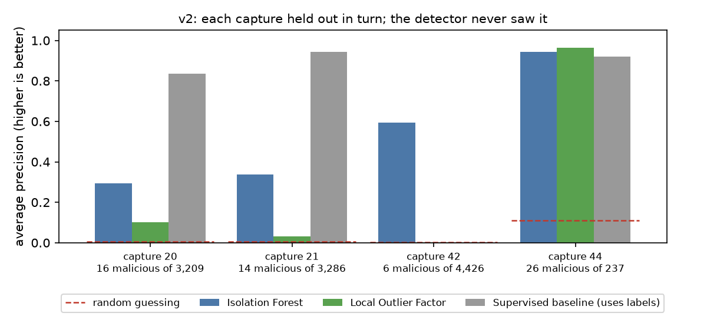

# ML Anomaly Detection in IoT Network Traffic

**Status:** v1 is a finished course assignment (2025). **v2 re-does it on the right setting and judges it honestly** (October 2026). Anomaly detection on malicious IoT connections: v1 caught almost none; v2 catches most of them on traffic it never saw.

**Contents:** [Version history](#version-history) · [v2 results](#v2-results) · [Run v2](#run-v2) · [v1 (coursework)](#v1-coursework)

## Version history

| | v1: coursework | v2 |
|---|---|---|
| Code | the notebook, tag [`v1-coursework`](https://github.com/G-Eskayo/ML_unsupervised_learning-anomaly-detection-project/tree/v1-coursework) | `anomaly_features.py`, `v2/run.py`, `tests/` |
| Data | one capture (34-1) that is **92% malicious** | four mostly-benign captures (20, 21, 42, 44), each held out in turn |
| Method | Isolation Forest told that 1% of traffic is anomalous | Isolation Forest and Local Outlier Factor trained on *other* captures, plus a supervised baseline |
| Scored with | accuracy, on the data it was fitted on | average precision and recall at a fixed false-alarm rate, on a capture it never saw |
| Malicious connections caught | **16 of 21,222** (recall 0.00) | Isolation Forest: **60% at 1% false alarms, 100% at 5%** (mean of 4 captures) |

**Why v1 failed.** Anomaly detection assumes anomalies are rare. Capture 34 is 92% malicious, so "flag the rarest 1%" picks the wrong rows by construction. The same method with the new features on that capture still catches only 120 of 21,222. The dataset has captures that *are* the textbook case (3,209 connections with 16 malicious), and v2 uses those.

## v2 results

**Read the walkthrough:** [`anomaly_detection_v2.ipynb`](anomaly_detection_v2.ipynb) explains why v1 failed, builds v2 step by step with its plots and outputs, and checks itself against `v2/results.json`.

Each of the four mostly-benign captures is held out in turn; the detectors are fitted on the other three without labels. Regenerate with `python v2/run.py` (full output in [`v2/results.json`](v2/results.json)).



| Mean over the 4 captures | Average precision | Recall at 1% false alarms | Recall at 5% false alarms |
|---|---|---|---|
| Random guessing | 0.03 | 0.01 | 0.05 |
| Isolation Forest | 0.54 | 0.60 | 1.00 |
| Local Outlier Factor | 0.27 | 0.31 | 0.40 |
| Supervised baseline (uses labels) | 0.68 | 0.63 | 0.73 |

Recall at 1% false alarms per capture (20 / 21 / 42 / 44): Isolation Forest 0.19 | 0.21 | 1.00 | 1.00; supervised baseline 0.94 | 1.00 | 0.00 | 0.58.

**What this says**
- A simple Isolation Forest, trained with no labels, ranks the malicious connections far above chance on captures it has never seen, and at a 5% false-alarm budget it catches every malicious connection in all four.
- **Labels help only for attacks the model has seen.** The supervised baseline is best on the Torii command-and-control captures (20, 21), where the other captures taught it what Torii looks like. On capture 42 (file download) it catches none at a 1% false-alarm rate while the unsupervised detector catches all of them: the supervised model cannot find what it was never shown.
- Local Outlier Factor is clearly worse here.

**Limits, plainly.** The malicious counts are tiny (6 to 26 per capture), so every number carries wide uncertainty and the differences between methods on one capture are not conclusive. These are four captures from one dataset, not a claim about real networks. Training samples are capped at 20,000 rows per capture.

### Run v2

```bash
scripts/fetch-data.sh       # downloads the Kaggle archive (755 MB) and unpacks the captures v2 uses
python -m venv .venv && .venv/bin/pip install scikit-learn pandas numpy matplotlib pytest
.venv/bin/python -m pytest tests -q
.venv/bin/python v2/run.py   # about 30 seconds; rewrites v2/results.json and the figure
.venv/bin/pip install nbformat nbconvert ipykernel && .venv/bin/python -m ipykernel install --user --name anomaly-v2
.venv/bin/python v2/build_notebook.py   # rebuilds the executed notebook
```

The plan, including why each choice was made, is in [`docs/v2-plan.md`](docs/v2-plan.md).

## v1 (coursework)

This project applies **unsupervised machine learning** to the **CTU-IoT Malware dataset**, with the goal of identifying anomalous network connections that may indicate **malware activity**. It demonstrates a full workflow of **EDA, preprocessing, feature engineering, and anomaly detection** for cybersecurity applications.

### Overview

- **Goal:** Detect malicious traffic in IoT network logs using unsupervised ML.
- **Dataset:** [CTU-IoT Malware Dataset (Kaggle)](https://www.kaggle.com/datasets/agungpambudi/network-malware-detection-connection-analysis)
- **Motivation:** Network logs contain millions of connections, but only a small fraction may be malicious. Detecting anomalies in high-dimensional data is a core cybersecurity challenge.

### Features

- **Exploratory Data Analysis (EDA):**
    - Inspected 23 features across ~23,000 network entries.
    - Analyzed categorical (IPs, ports, labels) and numerical attributes (packet size, duration).
- **Data Preprocessing:**
    - Dropped irrelevant/missing features.
    - Encoded categorical variables (IPs, ports).
    - Standardized numeric features with `StandardScaler`.
- **Feature Engineering:**
    - Created rolling counts of connections by source IP within 10-second windows.
    - Converted protocol-level details into categorical indicators.
- **Unsupervised Learning:**
    - Applied an `IsolationForest` anomaly detector to flag suspicious outliers.
- **Pipeline Design:**
    - Built scikit-learn pipelines with `ColumnTransformer` to unify preprocessing and modeling.

### Tech Stack

- **Language:** Python 3.x
- **Libraries:** pandas, numpy, scikit-learn, matplotlib, seaborn
- **Tools:** Jupyter Notebook

### How to Run

```bash
git clone https://github.com/G-Eskayo/ML_unsupervised_learning-anomaly-detection-project.git
cd ML_unsupervised_learning-anomaly-detection-project
pip install pandas numpy scikit-learn matplotlib seaborn jupyter
jupyter notebook ML_unsupervised_learning.ipynb
```

The notebook is also saved as [HTML](ML_unsupervised_learning.html) and [PDF](ML_unsupervised_learning.pdf) if you only want to read the results. Download the dataset from the Kaggle link above and point the notebook at it.


### What v1 found


The model is wrong in the way that matters: it catches **16 of 21,222** malicious connections (recall 0.00) and its overall accuracy is 0.07. The reason is visible in the data: 92% of these connections are malicious, but the notebook uses an `IsolationForest` set to flag the rarest 1% (`contamination=0.01`), an assumption that malicious traffic is rare. It is not here. Treat this as a worked pipeline and an honest negative result, not a detector.

### Example Outputs

- Correlation heatmaps for numeric features
- Connection distribution by IP/port
- Anomaly scores highlighting unusual connections

### Skills Demonstrated

- Machine Learning (clustering, anomaly detection)
- Data preprocessing & feature engineering for network traffic
- Cybersecurity analytics (malicious traffic detection)
- Model pipeline construction (scikit-learn)
- Visualization & interpretation of anomalies

### Project Structure

```
ML_unsupervised_learning.ipynb   v1: main notebook (also .html and .pdf)
Confusion Matrix.jpg             v1: the result shown above
anomaly_detection_v2.ipynb       v2: the executed walkthrough notebook
anomaly_features.py              v2: loading, features, hold-out splits, metrics
anomaly_experiment.py            v2: the experiment (shared by run.py and the notebook)
tests/test_anomaly_features.py   v2: 6 tests
v2/run.py                        v2: regenerates the results and the figure
v2/build_notebook.py             v2: rebuilds the notebook, executed
v2/results.json, v2/*.png        v2: the results
scripts/fetch-data.sh            v2: downloads the Kaggle archive
docs/v2-plan.md                  why v1 failed and what v2 sets out to do
```
